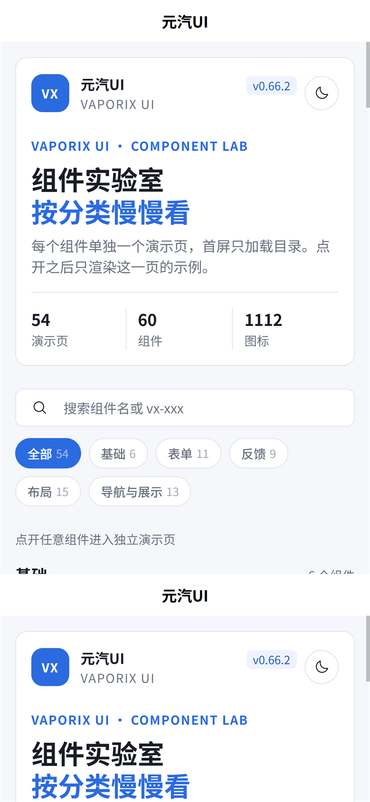
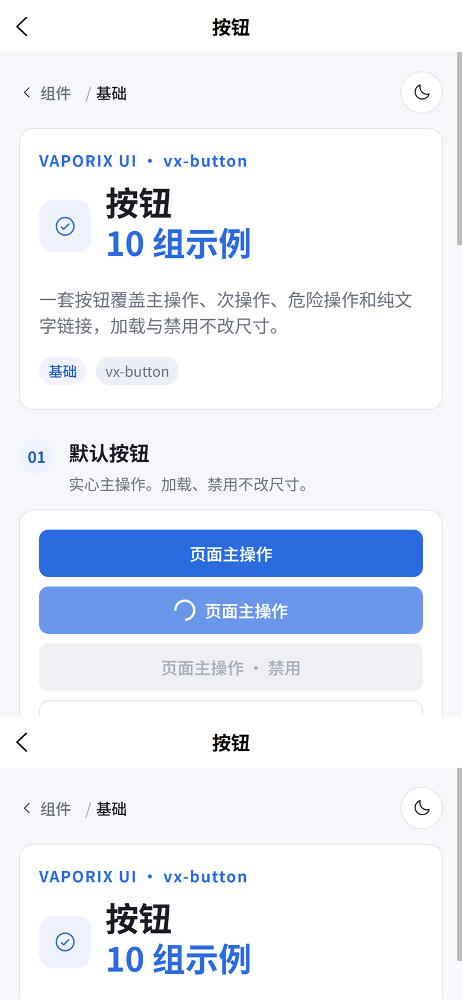
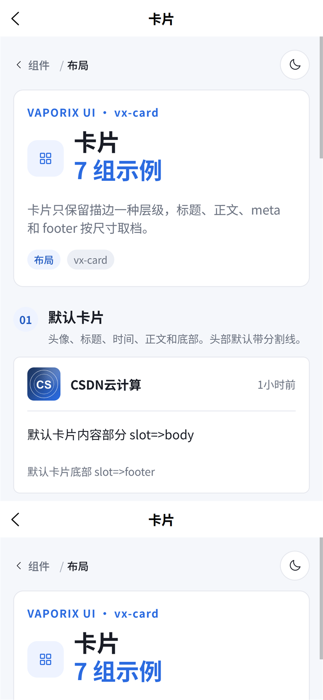

<p align="center">
	
</p>

<h1 align="center">Vaporix UI</h1>

<p align="center">
	Native-rendered component library for uni-app x vapor mode<br>
	60 components · 1112 icons · light and dark tokens · MIT free tier
</p>

<p align="center">
	<a href="https://www.vaporix-ui.com/en">Docs</a> ·
	<a href="https://www.vaporix-ui.com/en/components">Components</a> ·
	<a href="https://www.vaporix-ui.com/en/docs/install">Install</a> ·
	<a href="https://www.vaporix-ui.com/en/docs/pro">Pro components</a> ·
	<a href="uni_modules/vaporix-ui/changelog.md">Changelog</a> ·
	<a href="README.md">简体中文</a>
</p>

<p align="center">
	<a href="https://www.vaporix-ui.com/en/docs/install"></a>
	<a href="https://www.vaporix-ui.com/en/docs/install"></a>
	<a href="https://www.vaporix-ui.com/en/components"></a>
	<a href="https://www.vaporix-ui.com/en/components/icon"></a>
	<a href="./LICENSE"></a>
</p>

## Design language

Cool, low saturation, thin borders. Depth comes from whitespace and 1px borders; shadows are for overlays only.

| Item | Value |
| --- | --- |
| Tokens | Color, type, spacing, radius and height all come from `--vx-*`, one set per theme |
| Type | Page brand 28, section title 17, body 15, caption 13 |
| Controls | Heights 32 / 40 / 48, labels 14 / 16 / 18 |
| Radius | Controls 6 / 8 / 10, containers 8, edge panels 12 |
| Motion | Press 120ms, transition 220ms, spinner 700ms |

## Screenshots

<p align="center">
	
	
	
</p>

<p align="center">
	<sub>Catalog · buttons · cards (web demo; App builds are native)</sub>
</p>

## Why Vaporix UI

| Capability | Details |
| --- | --- |
| **Native rendering** | Vapor mode compiles uvue into native views; App builds never run in a WebView. |
| **No missing pieces** | 60 components carry an empty project to launch; Pro only adds upgraded and heavy items. |
| **Copy and use** | `uni_modules` plus easycom: drop the folder in, import tokens, enable vapor mode. |
| **Enough icons** | Phosphor 2.1.2, 112 core icons by default plus 1000 extended on demand. |

## Quick start

| Item | Requirement |
| --- | --- |
| HBuilderX | 5.26 or newer |
| Project | uni-app x with vapor mode |
| Style isolation | 2.0 enabled in `manifest.json` |
| App animation | `@keyframes` needs 5.31+; spinners stay still on earlier builds |

**1. Drop in the module**

Copy `uni_modules/vaporix-ui` into your project's `uni_modules`. `pages/` and `App.uvue` belong to the demo.

**2. Import tokens**

App, in `App.uvue`:

```vue
<style>
	/* #ifndef WEB */
	@import "@/uni_modules/vaporix-ui/libs/style/variables.css";
	/* #endif */
</style>
```

Web, in `main.uts`:

```ts
// #ifdef WEB
import "@/uni_modules/vaporix-ui/libs/style/variables.css"
// #endif
```

**3. Enable vapor mode and pick a theme**

`manifest.json`:

```json
{
	"uni-app-x": {
		"vapor": true,
		"styleIsolationVersion": "2",
		"vapor-render-target": "bytecode"
	}
}
```

Put `vx-theme-light` or `vx-theme-dark` on the page root:

```vue
<template>
	<view class="vx-theme-light">
		<vx-input v-model="keyword" placeholder="Keyword" clearable />
		<vx-tag type="success" variant="soft" text="Done" />
		<vx-button text="OK" type="primary" size="lg" />
	</view>
</template>
```

Easycom auto-scans, so no `custom` regex is needed. Prop tables live in the [component docs](https://www.vaporix-ui.com/en/components).

## Components

| Group | Count | Components |
| --- | :---: | --- |
| Basic | 6 | [Button](https://www.vaporix-ui.com/en/components/button) · [Icon](https://www.vaporix-ui.com/en/components/icon) · [Tag](https://www.vaporix-ui.com/en/components/tag) · [Badge](https://www.vaporix-ui.com/en/components/badge) · [Text](https://www.vaporix-ui.com/en/components/text) · [Link](https://www.vaporix-ui.com/en/components/link) |
| Form | 12 | [Input](https://www.vaporix-ui.com/en/components/input) · [Textarea](https://www.vaporix-ui.com/en/components/textarea) · [Number box](https://www.vaporix-ui.com/en/components/number-box) · [Radio](https://www.vaporix-ui.com/en/components/radio) · [Checkbox](https://www.vaporix-ui.com/en/components/checkbox) · [Switch](https://www.vaporix-ui.com/en/components/switch) · [Rate](https://www.vaporix-ui.com/en/components/rate) · [Datetime](https://www.vaporix-ui.com/en/components/datetime) · [Picker](https://www.vaporix-ui.com/en/components/picker) · [Calendar](https://www.vaporix-ui.com/en/components/calendar) · [Form](https://www.vaporix-ui.com/en/components/form) · [Form item](https://www.vaporix-ui.com/en/components/form-item) |
| Feedback | 11 | [Tips](https://www.vaporix-ui.com/en/components/tips) · [Toast](https://www.vaporix-ui.com/en/components/toast) · [Loading](https://www.vaporix-ui.com/en/components/loading) · [Load more](https://www.vaporix-ui.com/en/components/loadmore) · [No more](https://www.vaporix-ui.com/en/components/nomore) · [No data](https://www.vaporix-ui.com/en/components/no-data) · [Action sheet](https://www.vaporix-ui.com/en/components/actionsheet) · [Modal](https://www.vaporix-ui.com/en/components/modal) · [Drawer](https://www.vaporix-ui.com/en/components/drawer) · [Bubble popup](https://www.vaporix-ui.com/en/components/bubble-popup) · [Popup](https://www.vaporix-ui.com/en/components/popup) |
| Layout | 18 | [List view](https://www.vaporix-ui.com/en/components/list-view) · [List cell](https://www.vaporix-ui.com/en/components/list-cell) · [Card](https://www.vaporix-ui.com/en/components/card) · [Section](https://www.vaporix-ui.com/en/components/section) · [White space](https://www.vaporix-ui.com/en/components/white-space) · [Wing blank](https://www.vaporix-ui.com/en/components/wing-blank) · [Grid](https://www.vaporix-ui.com/en/components/grid) · [Grid item](https://www.vaporix-ui.com/en/components/grid-item) · [Row](https://www.vaporix-ui.com/en/components/row) · [Col](https://www.vaporix-ui.com/en/components/col) · [Image group](https://www.vaporix-ui.com/en/components/image-group) · [Collapse](https://www.vaporix-ui.com/en/components/collapse) · [Collapse item](https://www.vaporix-ui.com/en/components/collapse-item) · [Tabs](https://www.vaporix-ui.com/en/components/tabs) · [Sticky](https://www.vaporix-ui.com/en/components/sticky) · [Image](https://www.vaporix-ui.com/en/components/image) · [Divider](https://www.vaporix-ui.com/en/components/divider) · [Safe area](https://www.vaporix-ui.com/en/components/safe-area) |
| Navigation and display | 13 | [QR code](https://www.vaporix-ui.com/en/components/qrcode) · [Navigation bar](https://www.vaporix-ui.com/en/components/navigation-bar) · [Status bar](https://www.vaporix-ui.com/en/components/status-bar) · [Tab bar](https://www.vaporix-ui.com/en/components/tabbar) · [Footer](https://www.vaporix-ui.com/en/components/footer) · [Swipe action](https://www.vaporix-ui.com/en/components/swipe-action) · [Time axis](https://www.vaporix-ui.com/en/components/time-axis) · [Steps](https://www.vaporix-ui.com/en/components/steps) · [Progress](https://www.vaporix-ui.com/en/components/progress) · [Countdown](https://www.vaporix-ui.com/en/components/countdown) · [Rolling news](https://www.vaporix-ui.com/en/components/rolling-news) · [Notice bar](https://www.vaporix-ui.com/en/components/notice-bar) · [Avatar](https://www.vaporix-ui.com/en/components/avatar) |

The table covers the free tier. The 31 advanced components, including table, virtual list and image preview, ship in `vaporix-ui-pro`; see the [Pro page](https://www.vaporix-ui.com/en/docs/pro).

## Repository layout

This repository is also the demo project; the library is `uni_modules/vaporix-ui`.

```
vaporix-ui/
├── DESIGN.md                          Design values
├── App.uvue                           App entry, imports tokens outside web
├── main.uts                           Creates the app; imports tokens on web
├── manifest.json                      Vapor mode, style isolation 2.0
├── pages.json                         Routes, easycom and native tab bar
├── pages/
│   ├── index/index.uvue               Component catalog
│   ├── api/                           JS API catalog with examples
│   ├── mine/mine.uvue                 Theme and version
│   └── demo/
│       ├── shared/                    Catalog data, theme state, shared CSS
│       └── button/button.uvue         One page per component, 54 total
├── static/                            Tab bar icons, demo assets, README shots
└── uni_modules/vaporix-ui/
    ├── components/                    One directory per component
    ├── libs/style/variables.css       Tokens and core icon font faces
    ├── libs/style/icons-extend.css    Extended icon font faces (optional)
    ├── libs/                          JS modules: theme, form rules, dates, lunar, QR
    ├── readme.md                      Component API
    └── changelog.md                   Release notes
```

## Run locally

1. Open this directory in HBuilderX 5.26 or newer.
2. Confirm vapor mode is on in `manifest.json`. After moving machines, click "regenerate" for your own appid.
3. Run to a browser or a device. The browser build uses VDOM and does not represent App vapor rendering.

The demo has three tabs: 54 component pages, runnable examples for the `libs` modules, and theme plus version. Theme state lives in `pages/demo/shared/theme.ts`; switching `vx-theme-light` / `vx-theme-dark` on the page root swaps tokens.

To add a demo page, write `pages/demo/<name>/<name>.uvue`, register the route in `pages.json`, and add an entry to `DEMO_COMPONENTS` in `catalog.ts`.

## Conventions

1. `<script setup>` without `lang`. 5.26 compiles through uts2js; from 5.31 the default is TypeScript.
2. No UTS in components; native plugins go under `utssdk/`.
3. `size` is `sm | md | lg`, default `md`.
4. Single-class selectors; combined states use one class, such as `vx-button--plain-primary`.
5. A new component needs its own demo page plus entries in `catalog.ts`, `pages.json` and the library readme; new tokens go into both themes and `DESIGN.md`.

## Licensing

| Tier | Contents | License |
| --- | --- | --- |
| Free `vaporix-ui` | 60 components, 1112 icons, design tokens | [MIT](./LICENSE); personal and commercial use |
| Advanced `vaporix-ui-pro` | 31 components including table, virtual list, image preview | Sold separately; see the [Pro page](https://www.vaporix-ui.com/en/docs/pro) |

Icons come from Phosphor 2.1.2 (MIT); the license ships at `uni_modules/vaporix-ui/libs/icons/LICENSE`.

## Contributing

Fork the repository, create a `feat/<component>` branch, commit, then open a pull request.

Report bugs and ideas in [issues](https://gitee.com/DonkeySmall/vaporix-ui/issues). A star is welcome if the library helps you.
