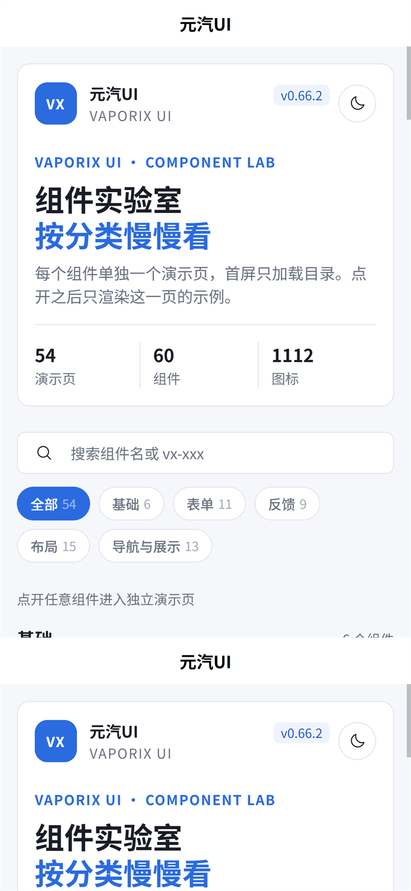
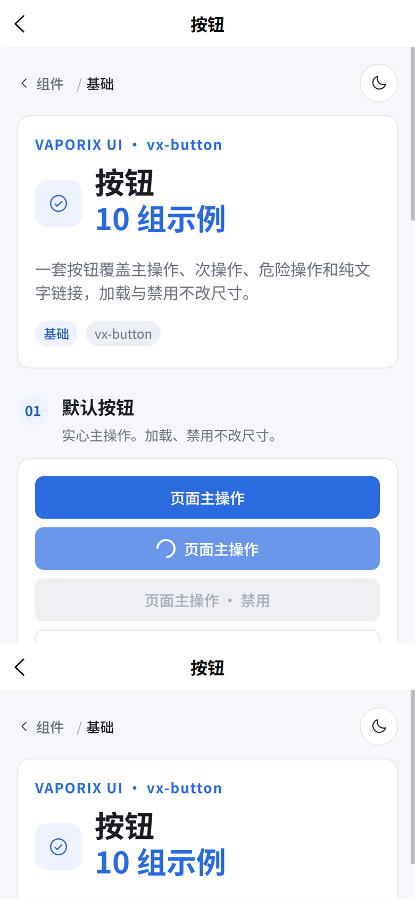
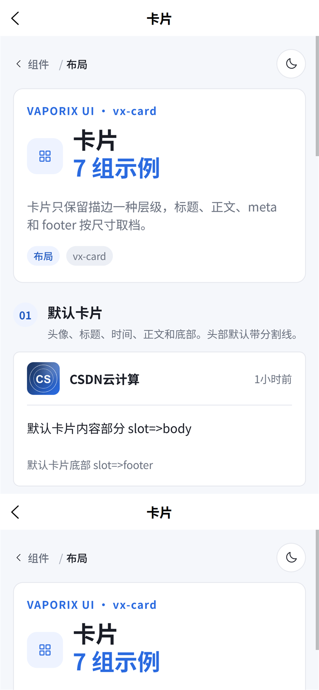

<p align="center">
	
</p>

<h1 align="center">元汽UI · Vaporix UI</h1>

<p align="center">
	uni-app x 蒸汽模式的高颜值、原生渲染组件库<br>
	<a href="https://www.vaporix-ui.com">https://www.vaporix-ui.com</a>
</p>

<p align="center">
	60 个组件 · 1112 个图标 · 亮暗两套令牌 · 免费层 MIT
</p>

<p align="center">
	<a href="https://www.vaporix-ui.com">文档</a> ·
	<a href="https://www.vaporix-ui.com/components">组件</a> ·
	<a href="https://www.vaporix-ui.com/docs/install">安装</a> ·
	<a href="https://www.vaporix-ui.com/docs/pro">Pro 组件</a> ·
	<a href="uni_modules/vaporix-ui/changelog.md">更新日志</a> ·
	<a href="README.en.md">English</a>
</p>

<p align="center">
	<a href="https://www.vaporix-ui.com/docs/install"></a>
	<a href="https://www.vaporix-ui.com/docs/install"></a>
	<a href="https://www.vaporix-ui.com/components"></a>
	<a href="https://www.vaporix-ui.com/components/icon"></a>
	<a href="./LICENSE"></a>
</p>

## 设计概念

冷色、低饱和、细描边。层级靠留白和 1px 描边，阴影只给浮层。

| 项 | 取值 |
| --- | --- |
| 令牌 | 颜色、字号、间距、圆角、高度全取 `--vx-*`，亮暗各一份 |
| 字号 | 页面品牌 28、区块标题 17、正文 15、辅助 13 |
| 控件 | 高度 32 / 40 / 48，文案 14 / 16 / 18 |
| 圆角 | 控件 6 / 8 / 10，容器 8，贴边面板 12 |
| 动效 | 按下 120ms，过渡 220ms，加载旋转 700ms |

## 截图

<p align="center">
	
	
	
</p>

<p align="center">
	<sub>组件目录 · 按钮 · 卡片（Web 演示，App 为原生渲染）</sub>
</p>

## 为什么用元汽UI

| 能力 | 说明 |
| --- | --- |
| **原生渲染** | 蒸汽模式把 uvue 编译成原生视图，App 端不走 WebView。 |
| **免费层不缺件** | 60 个组件够空项目走到上线，Pro 只补高配版和重型件。 |
| **复制即用** | `uni_modules` 加 easycom，放目录、引令牌、开蒸汽模式三步。 |
| **图标够用** | Phosphor 2.1.2，core 112 默认加载，extend 1000 按需引入。 |

## 快速开始

| 项 | 要求 |
| --- | --- |
| HBuilderX | 5.26 及以上 |
| 项目 | uni-app x，蒸汽模式 |
| 样式隔离 | `manifest.json` 里开启 2.0 |
| App 动效 | `@keyframes` 要 5.31 起，更早版本加载圈不旋转 |

**1. 放入模块**

复制 `uni_modules/vaporix-ui` 到项目的 `uni_modules` 下。`pages/`、`App.uvue` 属于演示工程，不复制。

**2. 引入令牌**

App 端在 `App.uvue`：

```vue
<style>
	/* #ifndef WEB */
	@import "@/uni_modules/vaporix-ui/libs/style/variables.css";
	/* #endif */
</style>
```

Web 端在 `main.uts`：

```ts
// #ifdef WEB
import "@/uni_modules/vaporix-ui/libs/style/variables.css"
// #endif
```

**3. 开蒸汽模式，挂主题**

`manifest.json`：

```json
{
	"uni-app-x": {
		"vapor": true,
		"styleIsolationVersion": "2",
		"vapor-render-target": "bytecode"
	}
}
```

页面根节点挂 `vx-theme-light` 或 `vx-theme-dark`：

```vue
<template>
	<view class="vx-theme-light">
		<vx-input v-model="keyword" placeholder="请输入关键词" clearable />
		<vx-tag type="success" variant="soft" text="已完成" />
		<vx-button text="确定" type="primary" size="lg" />
	</view>
</template>
```

easycom 自动扫描，不用写 `custom` 正则。属性表见[组件文档](https://www.vaporix-ui.com/components)。

## 组件一览

| 分类 | 数量 | 组件 |
| --- | :---: | --- |
| 基础 | 6 | [按钮](https://www.vaporix-ui.com/components/button) · [图标](https://www.vaporix-ui.com/components/icon) · [标签](https://www.vaporix-ui.com/components/tag) · [徽章](https://www.vaporix-ui.com/components/badge) · [文本](https://www.vaporix-ui.com/components/text) · [超链接](https://www.vaporix-ui.com/components/link) |
| 表单 | 12 | [输入框](https://www.vaporix-ui.com/components/input) · [多行输入框](https://www.vaporix-ui.com/components/textarea) · [数字框](https://www.vaporix-ui.com/components/number-box) · [单项选择器](https://www.vaporix-ui.com/components/radio) · [多项选择器](https://www.vaporix-ui.com/components/checkbox) · [开关选择器](https://www.vaporix-ui.com/components/switch) · [评分](https://www.vaporix-ui.com/components/rate) · [日期时间](https://www.vaporix-ui.com/components/datetime) · [联动选择](https://www.vaporix-ui.com/components/picker) · [日历](https://www.vaporix-ui.com/components/calendar) · [表单](https://www.vaporix-ui.com/components/form) · [表单项](https://www.vaporix-ui.com/components/form-item) |
| 反馈 | 11 | [消息提示](https://www.vaporix-ui.com/components/tips) · [轻提示](https://www.vaporix-ui.com/components/toast) · [加载中](https://www.vaporix-ui.com/components/loading) · [加载更多](https://www.vaporix-ui.com/components/loadmore) · [没有更多](https://www.vaporix-ui.com/components/nomore) · [暂无数据](https://www.vaporix-ui.com/components/no-data) · [操作菜单](https://www.vaporix-ui.com/components/actionsheet) · [弹框](https://www.vaporix-ui.com/components/modal) · [抽屉](https://www.vaporix-ui.com/components/drawer) · [气泡弹框](https://www.vaporix-ui.com/components/bubble-popup) · [弹出层](https://www.vaporix-ui.com/components/popup) |
| 布局 | 18 | [列表分组](https://www.vaporix-ui.com/components/list-view) · [列表行](https://www.vaporix-ui.com/components/list-cell) · [卡片](https://www.vaporix-ui.com/components/card) · [标题栏](https://www.vaporix-ui.com/components/section) · [上下留白](https://www.vaporix-ui.com/components/white-space) · [左右留白](https://www.vaporix-ui.com/components/wing-blank) · [宫格](https://www.vaporix-ui.com/components/grid) · [宫格项](https://www.vaporix-ui.com/components/grid-item) · [栅格布局](https://www.vaporix-ui.com/components/row) · [多端适配](https://www.vaporix-ui.com/components/col) · [图片组合](https://www.vaporix-ui.com/components/image-group) · [折叠面板](https://www.vaporix-ui.com/components/collapse) · [折叠项](https://www.vaporix-ui.com/components/collapse-item) · [标签页](https://www.vaporix-ui.com/components/tabs) · [吸顶容器](https://www.vaporix-ui.com/components/sticky) · [图片](https://www.vaporix-ui.com/components/image) · [分割线](https://www.vaporix-ui.com/components/divider) · [安全区](https://www.vaporix-ui.com/components/safe-area) |
| 导航与展示 | 13 | [二维码](https://www.vaporix-ui.com/components/qrcode) · [导航栏](https://www.vaporix-ui.com/components/navigation-bar) · [状态栏](https://www.vaporix-ui.com/components/status-bar) · [标签栏](https://www.vaporix-ui.com/components/tabbar) · [页脚](https://www.vaporix-ui.com/components/footer) · [滑动菜单](https://www.vaporix-ui.com/components/swipe-action) · [时间轴](https://www.vaporix-ui.com/components/time-axis) · [步骤条](https://www.vaporix-ui.com/components/steps) · [进度条](https://www.vaporix-ui.com/components/progress) · [倒计时](https://www.vaporix-ui.com/components/countdown) · [滚动消息](https://www.vaporix-ui.com/components/rolling-news) · [通告栏](https://www.vaporix-ui.com/components/notice-bar) · [头像](https://www.vaporix-ui.com/components/avatar) |

上表是免费层，Pro 见下一节。

## Pro 组件

免费层够把项目做到上线，Pro 补的是同一件事的高配版、跨控件的组合件和重型件。31 个组件，与免费层共用一套 `--vx-*` 令牌和 `vx-` 前缀，并列放在 `uni_modules`，easycom 一起扫描。

| 类型 | 组件 |
| --- | --- |
| 重型件 | [表格](https://www.vaporix-ui.com/components/table) · [虚拟列表](https://www.vaporix-ui.com/components/virtual-list) · [图片上传](https://www.vaporix-ui.com/components/upload) · [富文本](https://www.vaporix-ui.com/components/rich-text) · [拖拽排序](https://www.vaporix-ui.com/components/drag-list) |
| 组合件 | [页面容器](https://www.vaporix-ui.com/components/page)：导航栏、下拉刷新、触底加载收成一件 |
| 选择与输入 | [选择框](https://www.vaporix-ui.com/components/select) · [级联选择](https://www.vaporix-ui.com/components/cascader) · [树型菜单](https://www.vaporix-ui.com/components/tree-view) · [滑动选择](https://www.vaporix-ui.com/components/slider) · [分段器](https://www.vaporix-ui.com/components/segmented-control) · [数据选择器](https://www.vaporix-ui.com/components/data-checkbox) · [验证码输入框](https://www.vaporix-ui.com/components/code-input) · [数字键盘](https://www.vaporix-ui.com/components/keyboard) · [数字键盘输入框](https://www.vaporix-ui.com/components/keyboard-input) |
| 展示与动效 | [图片预览](https://www.vaporix-ui.com/components/gallery) · [轮播图](https://www.vaporix-ui.com/components/swiper) · [瀑布流](https://www.vaporix-ui.com/components/waterfall) · [滚动列表](https://www.vaporix-ui.com/components/scroll-list) · [索引列表](https://www.vaporix-ui.com/components/index-list) · [分隔列表](https://www.vaporix-ui.com/components/divide-list) · [分页器](https://www.vaporix-ui.com/components/pagination) · [筛选栏](https://www.vaporix-ui.com/components/dropdown) · [环形进度条](https://www.vaporix-ui.com/components/circular-progress) · [数字动画](https://www.vaporix-ui.com/components/count-to) · [骨架屏](https://www.vaporix-ui.com/components/skeleton) · [加载动画](https://www.vaporix-ui.com/components/loader) · [提示页](https://www.vaporix-ui.com/components/msg) · [压屏窗](https://www.vaporix-ui.com/components/landscape) · [新手引导](https://www.vaporix-ui.com/components/guide) · [返回顶部](https://www.vaporix-ui.com/components/back-top) |

**首发 ¥99 起**，按人授权，可选源码，12 个月同主版本更新。已免费的组件不会挪进 Pro。范围、价格和授权见 [Pro 组件](https://www.vaporix-ui.com/docs/pro)。

## 仓库结构

本仓库同时是演示工程，组件库在 `uni_modules/vaporix-ui`。

```
vaporix-ui/
├── DESIGN.md                          设计规范
├── App.uvue                           应用入口，非 Web 端引入令牌
├── main.uts                           创建应用；Web 端引入令牌
├── manifest.json                      蒸汽模式、样式隔离 2.0
├── pages.json                         路由、easycom 和原生 tabBar
├── pages/
│   ├── index/index.uvue               组件目录
│   ├── api/                           接口目录与示例
│   ├── mine/mine.uvue                 外观与版本
│   └── demo/
│       ├── shared/                    目录数据、主题状态、公共 CSS
│       └── button/button.uvue         组件演示页，共 54 页
├── static/                            tabBar 图标、演示素材、README 截图
└── uni_modules/vaporix-ui/
    ├── components/                    一个目录一个组件
    ├── libs/style/variables.css       设计令牌与 core 图标字体
    ├── libs/style/icons-extend.css    extend 图标字体（可选）
    ├── libs/                          JS 模块：主题、表单规则、日期、农历、二维码
    ├── readme.md                      组件 API
    └── changelog.md                   版本记录
```

## 本地运行

1. 用 HBuilderX 5.26+ 打开本目录。
2. 在 `manifest.json` 里确认已勾选蒸汽模式。换机器后点「重新获取」生成自己的 appid。
3. 运行到浏览器或真机。浏览器走 VDOM，不代表 App 蒸汽模式。

演示工程分三个 tab：组件是 54 个演示页，接口是 `libs` 模块的可运行示例，我的是外观与版本。主题状态在 `pages/demo/shared/theme.ts`，页面根节点切 `vx-theme-light` / `vx-theme-dark` 即换令牌。

新增演示页：写 `pages/demo/<name>/<name>.uvue`，在 `pages.json` 注册路由，在 `catalog.ts` 的 `DEMO_COMPONENTS` 登记。

## 开发约定

1. `<script setup>`，不写 `lang`。5.26 按 uts2js 编译，5.31 起默认 TypeScript。
2. 组件不写 UTS，原生插件才放 `utssdk/`。
3. `size` 只有 `sm | md | lg`，默认 `md`。
4. 样式只用单个 class，组合态写成一个，例如 `vx-button--plain-primary`。
5. 新组件补独立演示页，并在 `catalog.ts`、`pages.json` 和组件库 readme 登记；新令牌同时改亮色、暗色和 `DESIGN.md`。

## 授权

| 范围 | 内容 | 许可 |
| --- | --- | --- |
| 免费层 `vaporix-ui` | 60 个组件、1112 个图标、设计令牌 | [MIT](./LICENSE)，个人和商业项目都能用 |
| 高级层 `vaporix-ui-pro` | 表格、虚拟列表、图片预览等 31 个组件 | 单独销售，见 [Pro 组件](https://www.vaporix-ui.com/docs/pro) |

图标来自 Phosphor 2.1.2（MIT），许可全文在 `uni_modules/vaporix-ui/libs/icons/LICENSE`。

## 参与贡献

Fork 本仓库，新建 `feat/组件名` 分支，提交后发 Pull Request。

问题和建议提到 [Issues](https://gitee.com/DonkeySmall/vaporix-ui/issues)。觉得好用，点个 Star。
